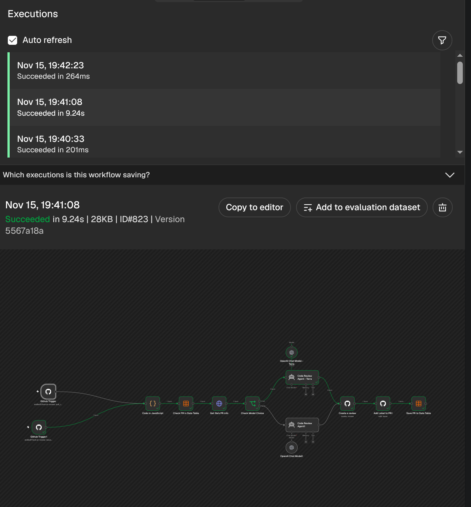
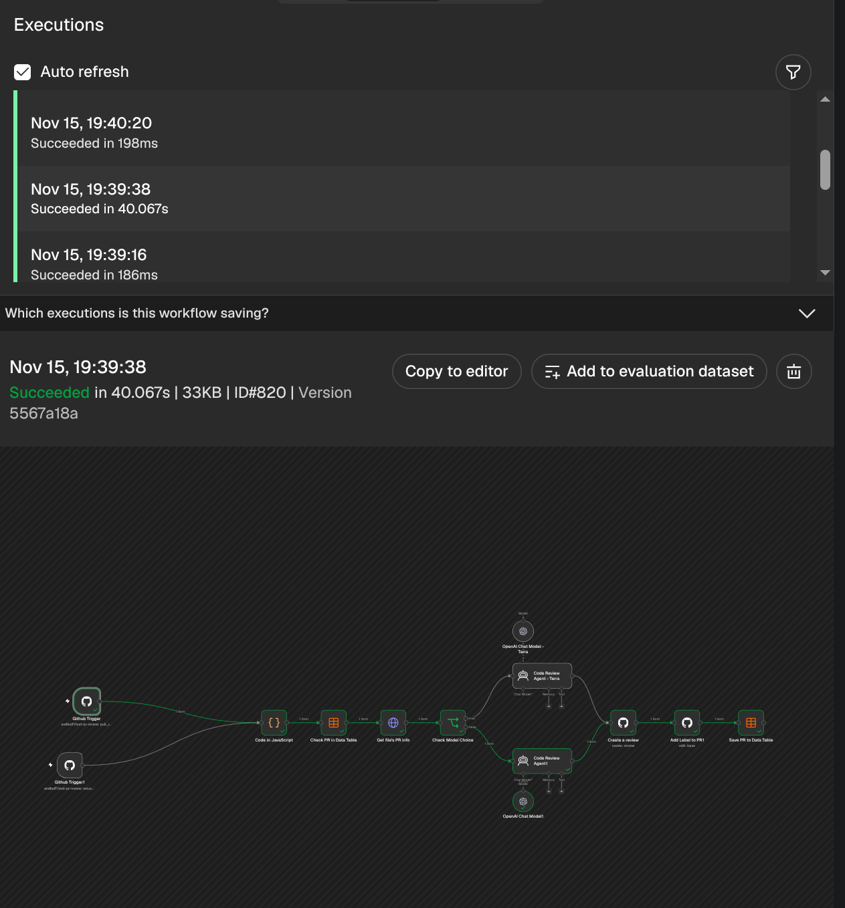
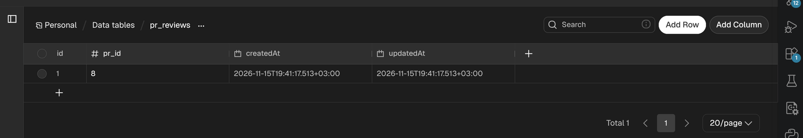
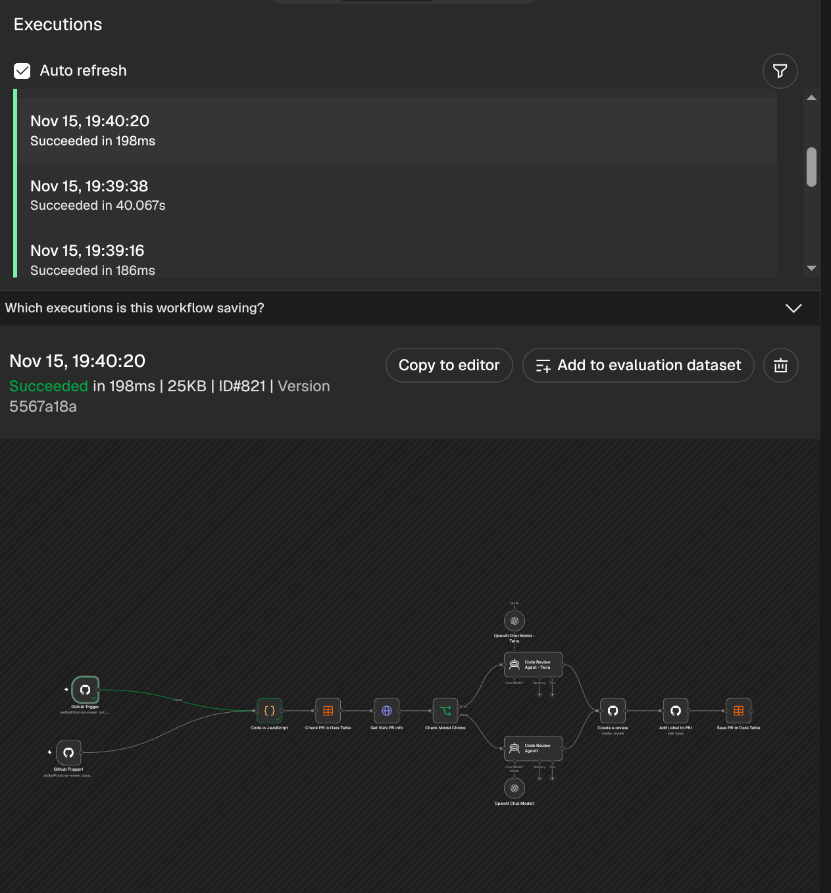

# Отчёт по Практике 7.1: Ассистент для код-ревью в n8n

## 1. Ссылка на тестовый Pull Request
- **GitHub PR:** https://github.com/andbelP/test-pr-review/pull/8

---

## 2. Экспорт сценария
- Доработанный сценарий в формате JSON: [`workflow.json`](./workflow.json)

---

## 3. Подтверждение выполнения критериев (Скриншоты)

### Критерий 1: Вторая модель по команде `/make_other_ai_review` (2 балла)
По команде `/make_other_ai_review` вызывается вторая модель (`gpt-6.1-terra`).
В истории Executions (ID #823) видно, что поток пошёл по верхней ветке к `Code Review Agent - Terra`:

---

### Критерий 2: Интеграция с Data Table и сохранение `pr_id` (2 балла)
После проведения ревью `pr_id` сохраняется в Data Table `pr_reviews`.
В Executions (ID #820) видно выполнение ноды `Save PR to Data Table`:

Содержимое таблицы Data Table `pr_reviews` с сохранённым `pr_id`:

---

### Критерий 3: Дедупликация повторных запусков (3 балла)
При повторной отправке команды `/make_ai_review` для уже проверенного PR нода `Check PR in Data Table` отсекает запуск (операция `If Row Does Not Exist`).
В Executions (ID #821) видно, что выполнение остановилось на проверке, последующие ноды не запускались, токены не тратились:

---

## 4. Ответы на вопросы для защиты

1. **Как устроен выбор модели для `/make_other_ai_review` и чем отличаются результаты двух моделей?**
   - В ноде `Code in JavaScript` проверяется текст комментария: при наличии строки `/make_other_ai_review` выставляется флаг `model_type: 'other'`, для остальных — `'main'`. Нода `Check Model Choice` (If) направляет запрос либо к агенту с GPT-6 Luna, либо к агенту с GPT-6.1 Terra. Обе модели формируют ревью с явным указанием своего имени в заголовке.
2. **Где хранится состояние и как сценарий решает, запускать ревью или нет?**
   - Состояние хранится во встроенной таблице n8n Data Table `pr_reviews`. Перед запросом diff нода `Check PR in Data Table` проверяет наличие строки с `pr_id == pr_number`. Если строка найдена, сценарий не пропускает поток дальше.
3. **Что происходит при повторном `/make_ai_review` к тому же PR?**
   - Выполнение завершается на ноде `Check PR in Data Table` без вызова агентов и отправки комментариев в GitHub.
