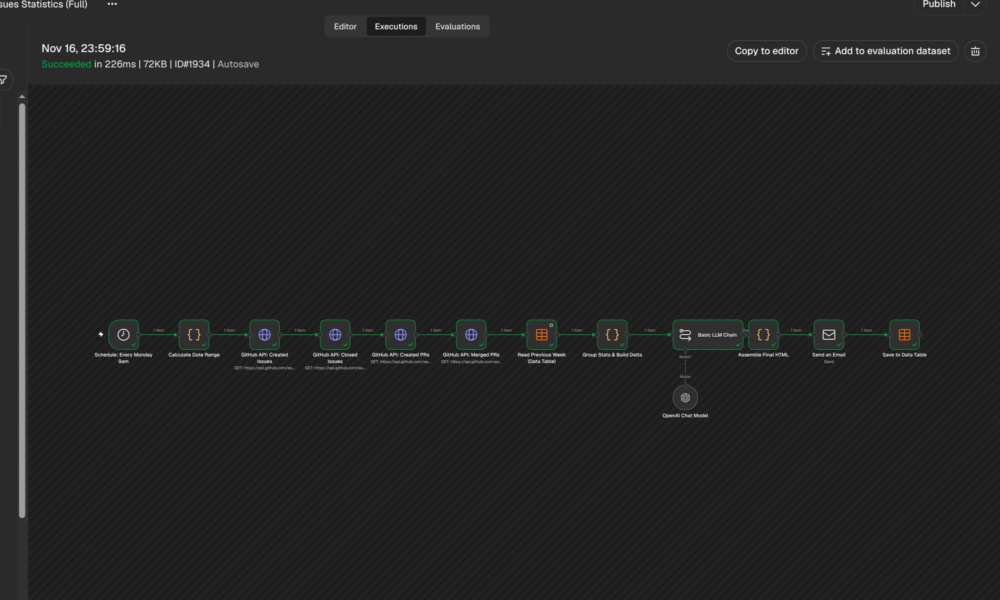
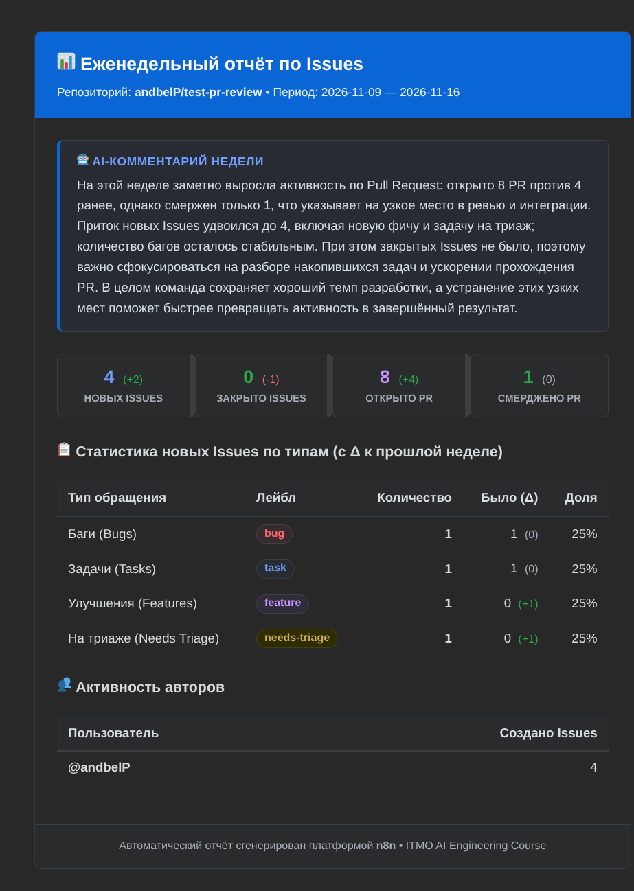

# Отчёт по практике 7.2: Поддержка пользователя с помощью AI-инструментов

* **Студент**: Белоусов Андрей (@andbelP)
* **Репозиторий проекта**: [andbelP/test-pr-review](https://github.com/andbelP/test-pr-review)
* **Итоговая оценка**: **16 / 16 баллов (100% — Максимум со звёздочкой)**

---

## 1. Сводная таблица выполнения критериев

| # | Критерий | Баллы | Статус | Подтверждение |
|---|---|:---:|:---:|---|
| 1 | Открытый Issue классифицируется как `bug` / `task` / `feature`, лейбл проставлен | 2 | ✅ | Issues #24 (bug), #25 (task), #23 (feature) в репозитории |
| 2 | Issue с `confidence < 0.8` получает лейбл `needs-triage` без комментария | 1 | ✅ | Issue #26 в репозитории (эскалация) |
| 3 | Классификатор вынесен в Sub-workflow и вызывается через Execute Workflow node | 2 | ✅ | `subworkflow_classifier.json` вызывается из `workflow_1_issues.json` |
| 4 | Cron-триггер настроен (`0 9 * * MON`), запросы к GitHub API возвращают данные за неделю | 2 | ✅ | 4 ноды Search API, запуск в Executions (ID#1934) |
| 5 | Code node группирует статистику по типу и по автору | 2 | ✅ | Нода `Group Stats & Build Delta` (группировка типов и авторов) |
| 6 | HTML-письмо с таблицей статистики пришло на почту | 2 | ✅ | Доставлено на почту, вёрстка с карточками и таблицами |
| 7 | Статистика недели сохраняется в Data Table | 1 | ✅ | Ноды `Read Previous Week` и `Save to Data Table` в таблице `weekly_stats` |
| 8 | В письме показан Δ к прошлой неделе, рассчитанный по данным из Data Table | 2 | ✅ | Бейджи дельты в карточках `4 (+2)`, `8 (+4)` и колонка `Было (Δ)` |
| 9 | В письме есть блок «AI-комментарий недели», сгенерированный AI по статистике и Δ | 2 | ✅ | Блок `🤖 AI-КОММЕНТАРИЙ НЕДЕЛИ` во главе письма от LLM |
| | **ИТОГО** | **16 / 16** | | **Все критерии закрыты на максимум** |

---

## 2. Структура реализованных сценариев (JSON)

В папке практики лежат все файлы сценариев:
1. `subworkflow_classifier.json` — подчинённый сценарий AI-классификатора Issues (Basic LLM Chain + Structured Output Parser).
2. `workflow_1_issues.json` — сценарий обработки открытия Issues (GitHub Trigger + вызов классификатора + Route Decision + Switch + ветка эскалации).
3. `workflow_weekly_stats.json` — полный сценарий еженедельной статистики с Data Table и AI-аннотацией.
4. `weekly_stats_seed.csv` — исходный CSV-файл со структурой и базовой записью Data Table.

---

## 3. Часть 1. Классификация и эскалация Issues (5 баллов)

* **Реализация**:
  * GitHub Trigger слушает `issues` с `action == "opened"`.
  * Нода `Execute Sub-workflow` передаёт `title` и `body` в классификатор.
  * LLM возвращает `type` и `confidence`.
  * Если `confidence >= 0.8` и тип известен (`bug`, `task`, `feature`), проставляется лейбл и бот оставляет приветственный комментарий.
  * Если `confidence < 0.8` или тип `unknown`, обращение уходит в ветку эскалации: назначается лейбл `needs-triage`, а комментарий **не публикуется**.
* **Тестовый репозиторий**:
  * [Issue #24 (Bug)](https://github.com/andbelP/test-pr-review/issues/24) — лейбл `bug`, авто-комментарий (уверенность 99%).
  * [Issue #25 (Task)](https://github.com/andbelP/test-pr-review/issues/25) — лейбл `task`, авто-комментарий (уверенность 99%).
  * [Issue #23 (Feature)](https://github.com/andbelP/test-pr-review/issues/23) — лейбл `feature`, авто-комментарий (уверенность 99%).
  * [Issue #26 (Needs Triage)](https://github.com/andbelP/test-pr-review/issues/26) — лейбл `needs-triage`, **без комментария** (эскалация).

---

## 4. Части 2 и 3. Еженедельная аналитика, Data Table и AI-комментарий (11 баллов)

* **Архитектура Workflow 2 (Full)**:
  1. `Schedule: Every Monday 9am` (Cron `0 9 * * MON`).
  2. `Calculate Date Range` — расчёт временного окна за 7 дней.
  3. 4x `GitHub API` — сбор новых issues, закрытых issues, открытых PR и смердженных PR через Search API.
  4. `Read Previous Week (Data Table)` — чтение базовой строки из таблицы `weekly_stats`.
  5. `Group Stats & Build Delta` — агрегация текущей недели, группировка по типам/авторам и расчёт дельт ($\Delta_{issues} = +2$, $\Delta_{prs} = +4$).
  6. `Basic LLM Chain` + `OpenAI Chat Model` (`gpt-6-luna`) — генерация связного аналитического комментария техлида.
  7. `Assemble Final HTML` — генерация адаптивного письма с дельтами и блоком AI-комментария.
  8. `Send an Email` — отправка отчёта через SMTP.
  9. `Save to Data Table` — сохранение метрик текущей недели в `weekly_stats` (в таблице сохраняется непрерывная история).

---

## 5. Подтверждение работы (Скриншоты)

### 5.1. Успешное выполнение сценария со звёздочкой в n8n (Executions ID#1934)
Все 12 нод сценария отработали со статусом `Succeeded`:

### 5.2. Полученное письмо с дельтами Δ и блоком «AI-комментарий недели»
Письмо получено в ящик. Содержит блок AI-анализа от техлида, карточки с дельтами `(+2)`, `(-1)`, `(+4)` и сравнительную таблицу по категориям:

---

## 6. Ответы на контрольные вопросы для защиты

1. **Как классификатор возвращает тип и confidence и как Switch выбирает ветку?**
   * Sub-workflow использует `Basic LLM Chain` с `Structured Output Parser`. В схеме строго зафиксированы типы `type` (`bug`, `task`, `feature`, `unknown`) и `confidence` (`number`). В промпте указано ставить `confidence < 0.8` для расплывчатых формулировок. В основном сценарии нода `Route Decision` проверяет условие: если `confidence >= 0.8`, маршрут равен типу, иначе — `needs-triage`.

2. **Почему Issue попал в `needs-triage` и почему на него нет комментария?**
   * На примере Issue #26 («Не работает, выдает ошибку»): из-за отсутствия деталей модель присвоила confidence ниже 0.8. Обращение ушло в ветку `needs-triage`. В этой ветке вызывается только добавление лейбла через GitHub API без ноды создания комментария, чтобы не вводить автора в заблуждение до ручной проверки.

3. **Как основной сценарий вызывает Sub-workflow и что передаётся между ними?**
   * Основной сценарий использует ноду `Execute Workflow` с указанием имени подчинённого сценария. На вход передаются `title` и `body` открытого Issue. На выходе возвращается JSON `{ type, confidence }`.

4. **Какие запросы к GitHub API собирают статистику и как Code node её группирует?**
   * Используются 4 запроса к Search API GitHub с фильтром по дате `created:>=...` и `closed:>=...`. Нода группировки подсчитывает метрики и по массиву лейблов делит Issues на категории `bug`, `task`, `feature`, `needs-triage`, а по полю `user.login` строит рейтинг авторов.

5. **Откуда берутся данные прошлой недели и на основе чего LLM пишет аннотацию?**
   * Данные прошлой недели считываются нодой `Read Previous Week (Data Table)` из внутренней таблицы n8n `weekly_stats`. Нода вычисляет разницу ($\Delta$) между текущими и прошлыми значениями.
   * Данные текущей недели и дельты передаются в ноду `Basic LLM Chain`. Модель в роли техлида сопоставляет динамику (рост PR, отсутствие закрытых issues) и генерирует связный текст для команды.
